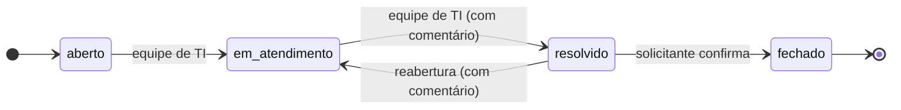
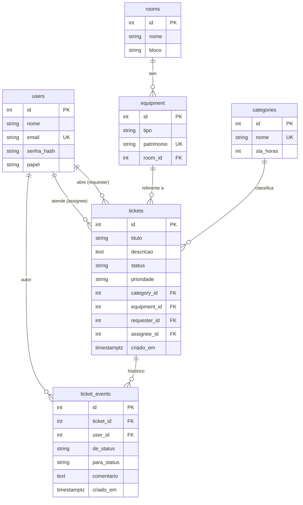

# HelpDesk TI

Sistema de chamados de TI para escolas, com triagem automática por IA.

## O problema

Em muitas escolas, os problemas de TI chegam por WhatsApp ou no corredor: "o projetor da sala 12 não liga", "a internet do laboratório caiu". Sem registro, não existe histórico, ninguém sabe quanto tempo leva para resolver e não dá para saber quais equipamentos quebram mais.

O HelpDesk TI organiza isso:

- o professor abre o chamado escolhendo a sala e o equipamento;
- a equipe de TI faz a triagem e acompanha o atendimento;
- os dados viram relatórios.

> Todos os dados do projeto (seed, testes e exemplos) são **fictícios**.

## Funcionalidades

| Fase | Entrega | Status |
| --- | --- | --- |
| **V1 — MVP** | CRUD de chamados, login JWT com papéis, Postgres + Alembic, Docker Compose, testes de integração e CI | ✅ |
| **V2 — Regras e relatórios** | Fluxo de status com histórico, permissões por papel em cada transição, relatórios SQL (CTE, ROLLUP, FILTER, window functions) | ✅ |
| **V2 — Front** | Interface web simples | 🔜 |
| **V3 — IA e deploy** | Triagem por LLM com classificador de reserva, métrica de acerto da IA, seed fictício e deploy público | 🔜 |

### Papéis

| Papel | Pode |
| --- | --- |
| `solicitante` (professor) | abrir chamados; ver e editar **apenas os próprios** (texto, enquanto estiver aberto); confirmar ou reabrir um chamado resolvido |
| `tecnico` | ver todos os chamados, fazer a triagem (prioridade, categoria, responsável), atender e resolver; ver relatórios |
| `admin` | tudo do técnico, mais cadastrar usuários, salas, equipamentos e categorias e excluir chamados |

### Fluxo de status



- Um chamado **não pode** pular etapas: de `aberto` direto para `fechado` a API responde `409`.
- Toda mudança vira uma linha em `ticket_events` (quem, quando, de/para e comentário). O status só muda por `POST /tickets/{id}/status`, nunca pelo `PATCH`, então nenhuma mudança fica sem registro.
- Quem inicia o atendimento de um chamado sem responsável vira o responsável.
- A linha do chamado fica travada (`SELECT ... FOR UPDATE`) durante a mudança, para que dois técnicos mexendo ao mesmo tempo não deixem o histórico inconsistente.
- A regra fica isolada em [`app/workflow.py`](app/workflow.py), com testes de unidade próprios.

### Relatórios

Escritos em SQL puro em [`app/reports.py`](app/reports.py). São consultas analíticas, e lê-las como SQL é mais claro do que pelo ORM.

| Rota | O que mostra | Recursos de SQL |
| --- | --- | --- |
| `/reports/tempo-resolucao` | Tempo médio e mediano de resolução e % dentro do SLA, por categoria e no total | CTE, `GROUP BY ROLLUP`, `PERCENTILE_CONT`, `INTERVAL` |
| `/reports/equipamentos` | Ranking dos equipamentos com mais chamados | `JOIN`, `RANK() OVER` |
| `/reports/salas` | Chamados por sala, quantos ainda em aberto e % do total | `LEFT JOIN`, `COUNT(*) FILTER`, `SUM() OVER ()` |
| `/reports/mensal` | Chamados por mês, com variação e acumulado | `generate_series`, `LAG() OVER`, soma acumulada, fuso horário |

Detalhes que contam:

- O tempo de resolução considera a **última** resolução, então um chamado reaberto conta a resolução definitiva.
- O mês é calculado no fuso da escola: um chamado aberto às 23h do dia 31 conta naquele mês, e não no seguinte (como aconteceria em UTC).
- Meses sem chamados aparecem com zero.

## Stack

- **Python 3.12** + **FastAPI**
- **PostgreSQL 17** + **SQLAlchemy 2** + **Alembic** (migrações)
- **JWT** (PyJWT) e senhas com **bcrypt**
- **pytest** com testes de integração contra Postgres real
- **Docker Compose** e **GitHub Actions** (lint, testes e checagem de migrações)

## Modelo de dados



Os valores de `papel`, `status` e `prioridade` também são validados no banco com `CHECK` constraints, e não só na API. A tabela `ai_predictions` (acerto da IA) entra na V3.

## Como rodar

Pré-requisito: Docker.

```bash
docker compose up -d --build
```

A API sobe em http://localhost:8000. A documentação interativa (Swagger) fica em http://localhost:8000/docs. As migrações rodam automaticamente na subida.

Crie o primeiro admin (a senha é pedida no terminal):

```bash
docker compose exec api python -m app.cli create-admin --nome "Admin" --email admin@escola.example.com
```

Depois, faça login em `POST /auth/login` (o campo `username` recebe o e-mail) ou pelo botão **Authorize** do Swagger.

## Testes

Os testes de integração rodam contra o banco `helpdesk_test`, que o Compose cria automaticamente no mesmo container do Postgres. O schema é montado pelas próprias migrações do Alembic, então os testes também validam as migrações.

```bash
python -m venv .venv
.venv\Scripts\activate        # Linux/macOS: source .venv/bin/activate
pip install -r requirements-dev.txt

docker compose up -d db
pytest
```

Alguns casos cobertos:

- **Regra de negócio:** um chamado não pode ir de `aberto` direto para `fechado`; resolver e reabrir exigem comentário.
- **Permissão:** um solicitante não enxerga, não edita e não vê o histórico do chamado de outro (recebe 404, para não revelar que o id existe).
- **Papéis:** só a equipe de TI faz a triagem e vê relatórios; só o admin cadastra e exclui.
- **Relatórios:** cenários com datas fixas conferem médias, mediana, SLA, empates no ranking, meses vazios e o fuso horário.
- **Autenticação:** token expirado, token inválido ou assinado com outra chave é recusado.
- **Validação:** o responsável precisa ser técnico ou admin; equipamento e categoria precisam existir; duplicatas retornam 409.

## Endpoints

| Método | Rota | Quem |
| --- | --- | --- |
| `POST` | `/auth/login` | público |
| `GET` | `/auth/me` | logado |
| `GET` / `POST` | `/users` | admin |
| `GET` | `/rooms`, `/equipment?room_id=`, `/categories` | logado |
| `POST` | `/rooms`, `/equipment`, `/categories` | admin |
| `GET` | `/tickets?status=&limit=&offset=` | logado (o solicitante vê só os próprios) |
| `POST` | `/tickets` | logado |
| `GET` / `PATCH` | `/tickets/{id}` | dono ou equipe de TI |
| `POST` | `/tickets/{id}/status` | conforme o fluxo de status |
| `GET` | `/tickets/{id}/events` | dono ou equipe de TI |
| `DELETE` | `/tickets/{id}` | admin |
| `GET` | `/reports/tempo-resolucao`, `/reports/equipamentos?limite=`, `/reports/salas`, `/reports/mensal` | equipe de TI |

## Estrutura

```
app/
  main.py          # cria o app e registra as rotas
  config.py        # configurações via variáveis de ambiente
  database.py      # engine, sessão e Base do SQLAlchemy
  models.py        # tabelas
  schemas.py       # validação de entrada e saída (Pydantic)
  security.py      # bcrypt e JWT
  deps.py          # usuário logado e checagem de papel
  workflow.py      # regras do fluxo de status
  reports.py       # relatórios em SQL
  cli.py           # comando create-admin
  routers/         # auth, users, catalog, tickets, reports
alembic/           # migrações
tests/             # testes de unidade (fluxo) e de integração (API + Postgres)
```
