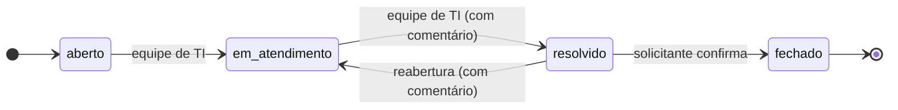
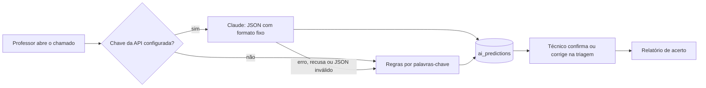
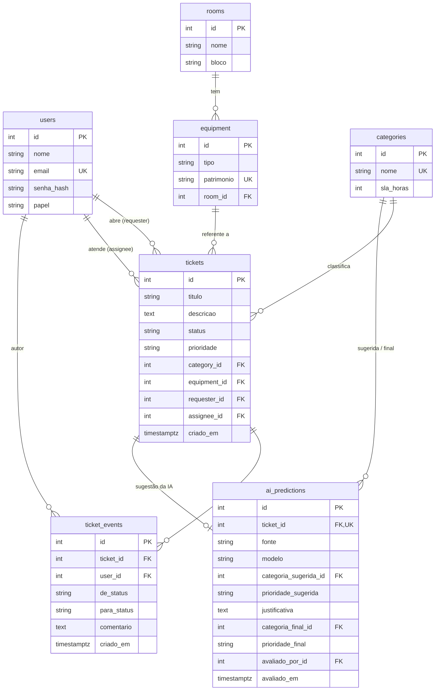

# HelpDesk TI

Sistema de chamados de TI para escolas, com triagem automática por IA.

## O problema

Em muitas escolas, os problemas de TI chegam por WhatsApp ou no corredor: "o projetor da sala 12 não liga", "a internet do laboratório caiu". Sem registro, não existe histórico, ninguém sabe quanto tempo leva para resolver e não dá para saber quais equipamentos quebram mais.

O HelpDesk TI organiza isso:

- o professor abre o chamado escolhendo a sala e o equipamento;
- a equipe de TI faz a triagem e acompanha o atendimento;
- os dados viram relatórios.

> Todos os dados do projeto (seed, testes e exemplos) são **fictícios**.

## Funcionalidades

| Fase | Entrega | Status |
| --- | --- | --- |
| **V1 — MVP** | CRUD de chamados, login JWT com papéis, Postgres + Alembic, Docker Compose, testes de integração e CI | ✅ |
| **V2 — Regras e relatórios** | Fluxo de status com histórico, permissões por papel em cada transição, relatórios SQL (CTE, ROLLUP, FILTER, window functions) | ✅ |
| **V2 — Front** | Interface em React: chamados, abertura, detalhe com histórico, triagem e relatórios | ✅ |
| **V3 — IA** | Triagem pelo Claude com classificador de reserva, métrica de acerto da IA no painel e seed com uma escola fictícia | ✅ |
| **V3 — Deploy** | Imagem única (API + front) publicada no Render, com o Postgres no Neon: [helpdesk-ti-2eaa.onrender.com](https://helpdesk-ti-2eaa.onrender.com) | ✅ |

### Papéis

| Papel | Pode |
| --- | --- |
| `solicitante` (professor) | abrir chamados; ver e editar **apenas os próprios** (texto, enquanto estiver aberto); confirmar ou reabrir um chamado resolvido |
| `tecnico` | ver todos os chamados, fazer a triagem (prioridade, categoria, responsável), atender e resolver; ver relatórios |
| `admin` | tudo do técnico, mais cadastrar usuários, salas, equipamentos e categorias e excluir chamados |

### Fluxo de status



- Um chamado **não pode** pular etapas: de `aberto` direto para `fechado` a API responde `409`.
- Toda mudança vira uma linha em `ticket_events` (quem, quando, de/para e comentário). O status só muda por `POST /tickets/{id}/status`, nunca pelo `PATCH`, então nenhuma mudança fica sem registro.
- Quem inicia o atendimento de um chamado sem responsável vira o responsável.
- A linha do chamado fica travada (`SELECT ... FOR UPDATE`) durante a mudança, para que dois técnicos mexendo ao mesmo tempo não deixem o histórico inconsistente.
- A regra fica isolada em [`app/workflow.py`](app/workflow.py), com testes de unidade próprios.

### Relatórios

Escritos em SQL puro em [`app/reports.py`](app/reports.py). São consultas analíticas, e lê-las como SQL é mais claro do que pelo ORM.

| Rota | O que mostra | Recursos de SQL |
| --- | --- | --- |
| `/reports/tempo-resolucao` | Tempo médio e mediano de resolução e % dentro do SLA, por categoria e no total | CTE, `GROUP BY ROLLUP`, `PERCENTILE_CONT`, `INTERVAL` |
| `/reports/equipamentos` | Ranking dos equipamentos com mais chamados | `JOIN`, `RANK() OVER` |
| `/reports/salas` | Chamados por sala, quantos ainda em aberto e % do total | `LEFT JOIN`, `COUNT(*) FILTER`, `SUM() OVER ()` |
| `/reports/mensal` | Chamados por mês, com variação e acumulado | `generate_series`, `LAG() OVER`, soma acumulada, fuso horário |
| `/reports/ia` | Acerto da triagem por IA, por fonte, e as correções mais comuns | CTE, `GROUP BY ROLLUP`, `FILTER`, `IS NOT DISTINCT FROM` |

Detalhes que contam:

- O tempo de resolução considera a **última** resolução, então um chamado reaberto conta a resolução definitiva.
- O mês é calculado no fuso da escola: um chamado aberto às 23h do dia 31 conta naquele mês, e não no seguinte (como aconteceria em UTC).
- Meses sem chamados aparecem com zero.

### Triagem por IA

Quando um chamado é aberto, a IA sugere a **categoria** (projetor, rede, impressora, som, lousa digital) e a **prioridade**. A sugestão aparece só para a equipe de TI, na triagem, com a justificativa e um botão "Usar sugestão". **Ela nunca altera o chamado sozinha:** quem decide é o técnico.



- **Modelo:** a API da Anthropic, pelo SDK oficial, com *structured outputs*. O schema da resposta restringe a categoria às cadastradas no banco (`enum`), então o modelo não inventa categorias.
- **Classificador de reserva:** sem chave configurada, ou se a chamada falhar (rede, timeout, recusa, resposta inválida), entra um classificador por palavras-chave ([`app/triage.py`](app/triage.py)). O chamado nunca fica sem sugestão por causa da IA.
- **Não atrasa quem abre o chamado:** a análise roda em segundo plano, depois da resposta. O front da equipe atualiza sozinho quando a sugestão chega.
- **Texto do professor é dado, não instrução:** ele vai delimitado no prompt, que manda ignorar instruções dentro dele, e a saída é presa ao schema.
- **Acerto medido de verdade:** a decisão da triagem fica gravada ao lado da sugestão. O relatório `/reports/ia` compara as duas (categoria, prioridade e ambas), separa por fonte (modelo ou regras) e lista as correções mais comuns.

## Stack

- **Python 3.12** + **FastAPI**
- **PostgreSQL 17** + **SQLAlchemy 2** + **Alembic** (migrações)
- **JWT** (PyJWT) e senhas com **bcrypt**
- **Claude** (API da Anthropic, SDK `anthropic`) para a triagem, com *structured outputs*
- **pytest** com testes de integração contra Postgres real
- **React 19** + **TypeScript** + **Vite**, com **TanStack Query** e **React Router**; testes com **Vitest** e **Testing Library**
- **nginx** servindo o front e repassando `/api` para a API (mesma origem, sem CORS)
- **Docker Compose** e **GitHub Actions** (lint, testes, checagem de migrações e build do front)

## Modelo de dados



Os valores de `papel`, `status`, `prioridade` e `fonte` também são validados no banco com `CHECK` constraints, e não só na API.

## Como rodar

Pré-requisito: Docker.

```bash
docker compose up -d --build
```

| Serviço | Endereço |
| --- | --- |
| Interface web | http://localhost:8080 |
| API | http://localhost:8000 (Swagger em `/docs`) |

As migrações rodam automaticamente na subida.

**Dados de demonstração.** O seed cria uma escola fictícia: 10 salas, equipamentos, 2 técnicos, 8 professores e 160 chamados espalhados pelos últimos 6 meses, em todas as etapas do fluxo. A senha dos usuários de demonstração é pedida no terminal:

```bash
docker compose exec api python -m app.seed
```

Depois, entre como `tecnico@escola.example.com` (equipe de TI) ou `professora@escola.example.com` (professora). Para recriar tudo do zero: `python -m app.seed --reset` (apaga todos os dados).

As sugestões de IA do seed são geradas pelo classificador por palavras-chave de verdade, e não inventadas. Por isso a taxa de acerto que aparece no painel é medida.

**Triagem com o Claude.** Sem configuração, a triagem usa o classificador por palavras-chave. Para usar o modelo, defina a chave antes de subir:

```bash
ANTHROPIC_API_KEY=sk-ant-... docker compose up -d
```

O modelo padrão é `claude-opus-5-5` (`TRIAGE_MODEL` troca).

**Admin.** Para cadastrar salas, equipamentos e usuários pelo Swagger, crie um admin (a senha é pedida no terminal):

```bash
docker compose exec api python -m app.cli create-admin --nome "Admin" --email admin@escola.example.com
```

### Front em modo de desenvolvimento

Com a API rodando, o Vite sobe com recarga automática e repassa `/api` para `localhost:8000`:

```bash
cd frontend
npm install
npm run dev
```

O front fica em http://localhost:5173. Se a API estiver em outra porta, use `API_URL=http://localhost:8001 npm run dev`.

## Deploy

Para publicar, há uma imagem única ([`Dockerfile.deploy`](Dockerfile.deploy)): ela compila o front e serve tudo pelo FastAPI, com a API em `/api` e o React em `/`. Na subida ([`scripts/start.sh`](scripts/start.sh)), ela:

1. aplica as migrações;
2. popula a escola fictícia se `DEMO_PASSWORD` estiver definida e o banco estiver vazio;
3. sobe o servidor na porta `PORT` que a plataforma define.

| Variável | Obrigatória | Para quê |
| --- | --- | --- |
| `DATABASE_URL` | sim | Postgres. Aceita `postgres://` e `postgresql://` como as plataformas entregam |
| `JWT_SECRET` | sim | Chave aleatória com 32+ caracteres. Com a chave de desenvolvimento, o serviço não sobe |
| `DEMO_PASSWORD` | não | Senha dos usuários de demonstração do seed |
| `ANTHROPIC_API_KEY` | não | Liga a triagem pelo Claude; sem ela, usa as regras |
| `TRIAGE_MODEL` | não | Modelo da triagem (padrão `claude-opus-5-5`) |

**Render + Neon:** o site roda no Render e o Postgres no [Neon](https://neon.com), porque o Postgres grátis do Render vence em 30 dias e o do Neon não.

1. No Neon, crie um projeto e copie a URL de conexão **direta** (sem *connection pooling*: as migrações não combinam com o pooler).
2. Em render.com, vá em **New → Blueprint** e escolha o repositório. O [`render.yaml`](render.yaml) cria o serviço web.
3. Preencha `DATABASE_URL` (a URL do Neon), `DEMO_PASSWORD` e, se quiser, `ANTHROPIC_API_KEY`.

> Numa demo pública com a chave da API ligada, cada chamado aberto gera uma chamada paga ao modelo. Defina um limite de gastos no Console da Anthropic, ou deixe a demo só com o classificador de regras.

## Testes

Os testes de integração rodam contra o banco `helpdesk_test`, que o Compose cria automaticamente no mesmo container do Postgres. O schema é montado pelas próprias migrações do Alembic, então os testes também validam as migrações.

```bash
python -m venv .venv
.venv\Scripts\activate        # Linux/macOS: source .venv/bin/activate
pip install -r requirements-dev.txt

docker compose up -d db
pytest
```

Alguns casos cobertos:

- **Regra de negócio:** um chamado não pode ir de `aberto` direto para `fechado`; resolver e reabrir exigem comentário.
- **Permissão:** um solicitante não enxerga, não edita e não vê o histórico do chamado de outro (recebe 404, para não revelar que o id existe).
- **Papéis:** só a equipe de TI faz a triagem e vê relatórios; só o admin cadastra e exclui.
- **Relatórios:** cenários com datas fixas conferem médias, mediana, SLA, empates no ranking, meses vazios e o fuso horário.
- **Autenticação:** token expirado, token inválido ou assinado com outra chave é recusado.
- **Validação:** o responsável precisa ser técnico ou admin; equipamento e categoria precisam existir; duplicatas retornam 409.
- **IA com dublê:** nenhum teste chama a API de verdade. Um cliente falso confere o pedido (schema com as categorias do banco, texto do professor delimitado) e simula respostas e falhas: erro de conexão, timeout, recusa, JSON inválido. Em todas, o sistema cai para as regras e o chamado continua com sugestão. Também é testado que só a equipe vê a sugestão e que o relatório mede o acerto.
- **Seed:** todo chamado gerado segue o fluxo de status (transições permitidas, em ordem, com comentário onde é exigido), e a mesma semente gera a mesma escola.
- **Deploy:** a imagem única serve a API em `/api`, os arquivos do build e as rotas do React, não deixa ler arquivos fora do build e não sobe com a chave JWT de desenvolvimento.

No front (`cd frontend && npm test`):

- O login mostra o erro da API e guarda o token.
- Os botões de andamento só aparecem para as mudanças permitidas, e resolver ou reabrir só é liberado depois que o comentário é escrito.

## Endpoints

| Método | Rota | Quem |
| --- | --- | --- |
| `POST` | `/auth/login` | público |
| `GET` | `/auth/me` | logado |
| `GET` / `POST` | `/users` | admin |
| `GET` | `/users/equipe` | equipe de TI (opções de responsável) |
| `GET` | `/rooms`, `/equipment?room_id=`, `/categories` | logado |
| `POST` | `/rooms`, `/equipment`, `/categories` | admin |
| `GET` | `/tickets?status=&limit=&offset=` | logado (o solicitante vê só os próprios) |
| `POST` | `/tickets` | logado |
| `GET` / `PATCH` | `/tickets/{id}` | dono ou equipe de TI (o `GET` inclui as mudanças de status que o usuário pode fazer e, para a equipe, a sugestão da IA) |
| `POST` | `/tickets/{id}/status` | conforme o fluxo de status |
| `GET` | `/tickets/{id}/events` | dono ou equipe de TI |
| `DELETE` | `/tickets/{id}` | admin |
| `GET` | `/reports/tempo-resolucao`, `/reports/equipamentos?limite=`, `/reports/salas`, `/reports/mensal`, `/reports/ia` | equipe de TI |

## Estrutura

```
app/
  main.py          # cria o app e registra as rotas
  config.py        # configurações via variáveis de ambiente
  database.py      # engine, sessão e Base do SQLAlchemy
  models.py        # tabelas
  schemas.py       # validação de entrada e saída (Pydantic)
  security.py      # bcrypt e JWT
  deps.py          # usuário logado e checagem de papel
  workflow.py      # regras do fluxo de status
  reports.py       # relatórios em SQL
  triage.py        # triagem por IA (Claude + classificador de reserva)
  seed.py          # escola fictícia para demonstração
  web.py           # deploy em um serviço: API em /api e o front em /
  cli.py           # comando create-admin
  routers/         # auth, users, catalog, tickets, reports
alembic/           # migrações
tests/             # testes de unidade (fluxo) e de integração (API + Postgres)
frontend/
  src/
    api.ts         # cliente HTTP (token, erros, 401)
    auth.tsx       # sessão do usuário
    pages/         # login, chamados, novo chamado, detalhe, relatórios
    components/    # layout, badges, ações de status, barras
  nginx.conf       # serve o build e repassa /api para a API
scripts/start.sh   # subida no deploy: migrações, seed e servidor
Dockerfile.deploy  # imagem única para deploy público
render.yaml        # blueprint do Render (serviço web; o Postgres fica no Neon)
```
